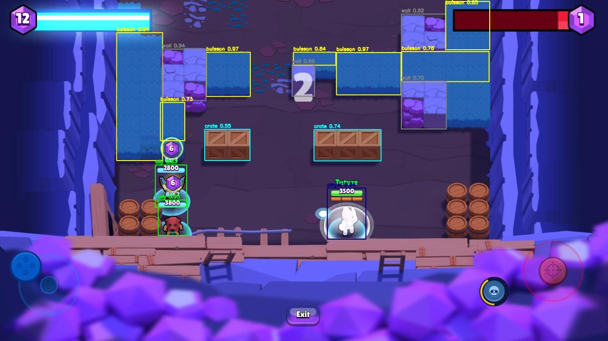
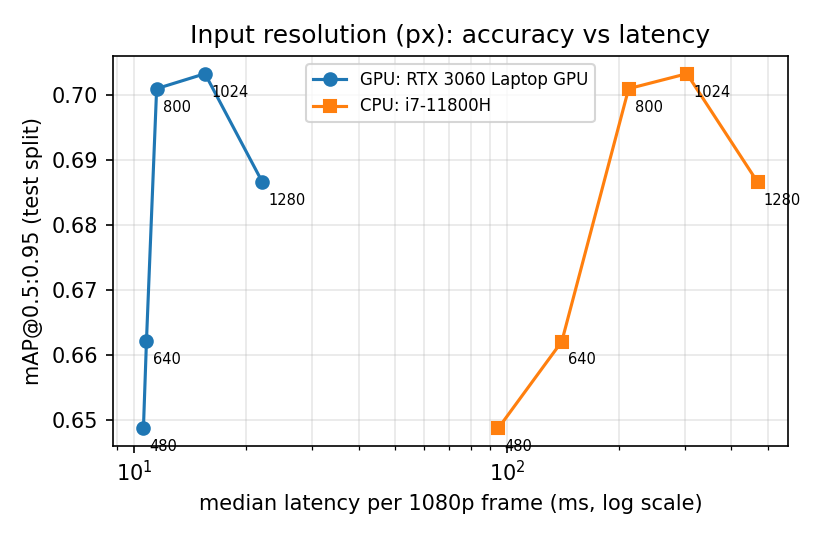
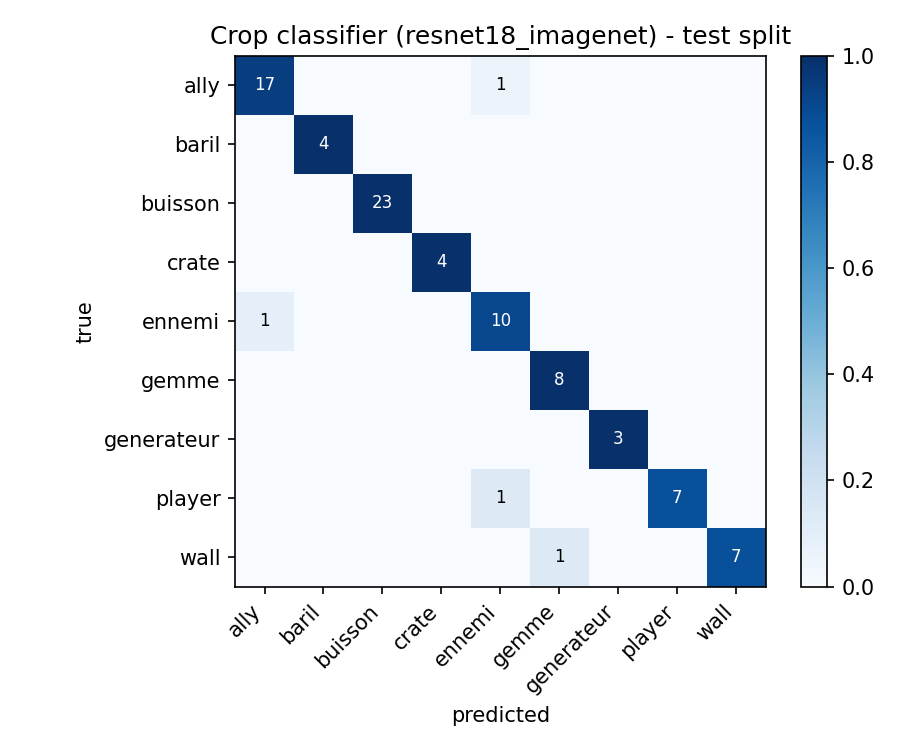
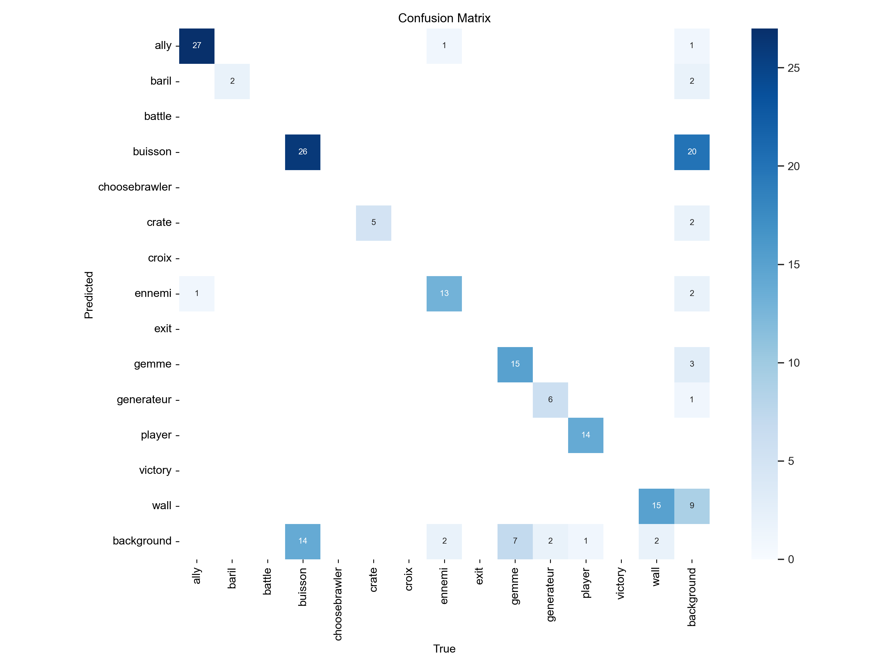
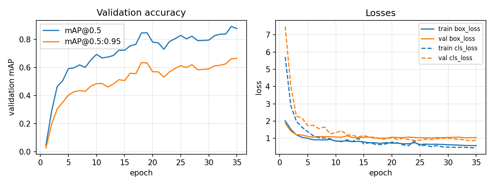

# Real-time object detection in mobile-game footage

Fine-tuning a COCO-pretrained **YOLOv8s** on **93 hand-annotated gameplay screenshots** (959 boxes) of the
mobile game *Brawl Stars*, then running it live on an Android emulator window.
The model reaches **0.89 mAP@0.5 / 0.70 mAP@0.5:0.95 on a held-out test split** and processes a 1080p frame in
**11.5 ms (87 FPS) on a laptop RTX 3060**.

The repository also contains two small studies built on top of the detector:
- **Input resolution vs. accuracy and latency**: is 800 px the right operating point?
- **A second-stage crop classifier written in plain PyTorch**: given a correct box, how separable are the
  classes (player / ally / enemy, bush / wall)? This separates classification errors from localisation errors.

**Technical report (3 pages, PDF): [`report/report.pdf`](report/report.pdf)**



> Scope: perception only. This repository contains no code that sends inputs to the game.

## Results

### Detection (YOLOv8s, 800 px input)

| Split | Images | Boxes | mAP@0.5 | mAP@0.5:0.95 | Precision | Recall |
|---|---:|---:|---:|---:|---:|---:|
| Validation (used to pick the best epoch) | 19 | 153 | 0.876 | 0.668 | 0.812 | 0.812 |
| **Test (held out)** | 9 | 87 | **0.893** | **0.701** | 0.846 | 0.843 |

Per class (test, AP@0.5): `ally` 0.995, `player` 0.995, `crate` 0.995, `generateur` 0.995, `baril` 0.945,
`gemme` 0.944, `ennemi` 0.900, `wall` 0.750, **`buisson` (bush) 0.515**. Bushes are the hard class: they are large,
irregular and merge into each other, so box boundaries are ambiguous (AP@0.5 is also the lowest on validation, 0.611).
Full numbers: [`results/eval_test.json`](results/eval_test.json), [`results/eval_val.json`](results/eval_val.json).

### Input resolution: accuracy vs. latency

Same model, evaluated on the test split at several input sizes. Latency = median wall-clock time of
`model.predict` per 1080p frame (pre-processing + inference + NMS), batch size 1, FP32.

| Input size | mAP@0.5 | mAP@0.5:0.95 | GPU latency (RTX 3060 Laptop) | CPU latency (i7-11800H) |
|---:|---:|---:|---:|---:|
| 480 px | 0.854 | 0.649 | 10.6 ms (94 FPS) | 95 ms (10.5 FPS) |
| 640 px | 0.843 | 0.662 | 10.8 ms (92 FPS) | 140 ms (7.1 FPS) |
| **800 px** (training size) | **0.893** | **0.701** | **11.5 ms (87 FPS)** | 212 ms (4.7 FPS) |
| 1024 px | 0.905 | 0.703 | 15.5 ms (65 FPS) | 304 ms (3.3 FPS) |
| 1280 px | 0.897 | 0.687 | 22.1 ms (45 FPS) | 470 ms (2.1 FPS) |

Accuracy saturates around the training resolution, but the cost of resolution depends on the hardware.
On the GPU, latency barely moves between 480 and 800 px (+0.9 ms), consistent with a GPU that is under-used
by single small images, so 800 px is free and runs at 87 FPS. On the CPU, latency grows roughly with the number
of pixels, and 480 px halves it for about 5 points of mAP@0.5:0.95. With 9 test images, accuracy differences
of ±0.02 are within noise.
Data: [`results/resolution_tradeoff_test_gpu.csv`](results/resolution_tradeoff_test_gpu.csv),
[`results/resolution_tradeoff_test_cpu.csv`](results/resolution_tradeoff_test_cpu.csv).



### Where do the detector's errors come from? A crop classifier in plain PyTorch

[`src/train_crop_classifier.py`](src/train_crop_classifier.py) cuts every annotated box out of the images
(713 / 153 / 87 crops of the nine in-game classes, with 15 % context around each box) and trains a classifier
with a hand-written PyTorch loop: class-weighted cross-entropy, AdamW, cosine schedule, model selection on
validation macro-F1, a single final evaluation on test.

| Classifier | Initialisation | Val accuracy / macro-F1 | Test accuracy / macro-F1 |
|---|---|---:|---:|
| ResNet-18 (11.2 M params) | ImageNet | 0.980 / 0.983 | **0.954 / 0.958** |
| Small CNN (0.39 M params) | random | 0.967 / 0.972 | 0.931 / 0.948 |

- **Bushes are easy to recognise but hard to delimit.** Given the annotated box, the ResNet-18 classifies every
  bush correctly (40/40 validation, 23/23 test). In the detector's confusion matrix (validation, confidence 0.25,
  IoU 0.45), bushes are never confused with another class: 14 of the 40 bushes are missed and 20 predicted bush
  boxes match no annotation. Bushes form large clusters whose split into boxes is ambiguous, so the detector's
  weakest class fails on localisation, not recognition. Stricter annotation rules for bush clusters should help
  more than a bigger model.
- **The remaining classification errors are between characters** (player / ally / enemy, which differ mostly by
  team markers): 3 of the 4 ResNet-18 test errors. The detector itself confuses only 2 of 153 validation boxes
  (one ally and one enemy).
- **ImageNet pre-training mainly speeds up convergence** (validation macro-F1 0.96 after 10 epochs, against 0.69
  from scratch); the final scores differ by about 1 point, which is within noise on 87 test crops.

| Crop classifier, test split | Detector, validation split |
|---|---|
|  |  |

### Training curves

Recovered from the released checkpoint with [`tools/extract_training_log.py`](tools/extract_training_log.py)
(the log stored in `best.pt` stops at epoch 35, the selected epoch).



## Dataset

- 1920×1080 screenshots of an Android emulator (BlueStacks) captured with [`src/capture.py`](src/capture.py),
  annotated by hand on Roboflow: **93 images, 959 boxes, split 65 / 19 / 9** (train / validation / test).
- Public on Roboflow Universe under **CC BY 4.0**:
  [brawlll / brawl-stars-bot-16ycf](https://universe.roboflow.com/brawlll/brawl-stars-bot-16ycf).
  Version 1 is the raw split; version 2 (used for the released model) triples the training images offline
  with horizontal flips and ±25 % saturation. Validation and test images are identical in both versions.
- 14 classes. The labels are the original French names stored in the model:

| Class | Meaning | Boxes (train / val / test) |
|---|---|---|
| `buisson` | bush | 224 / 40 / 23 |
| `wall` | wall | 121 / 17 / 8 |
| `ally` | teammate | 102 / 28 / 18 |
| `ennemi` | enemy | 76 / 16 / 11 |
| `gemme` | gem | 58 / 22 / 8 |
| `player` | controlled character | 52 / 15 / 8 |
| `generateur` | gem generator | 37 / 8 / 3 |
| `crate` | crate | 25 / 5 / 4 |
| `baril` | barrel | 19 / 2 / 4 |
| `battle`, `choosebrawler`, `exit`, `victory`, `croix` | menu / UI elements, cross marker | 1 each / 0 / 0 |

The five UI classes have a single training example and none in validation or test, so the reported mAP covers
the nine in-game classes.

## Method

- **Detector**: YOLOv8s (11.1 M parameters) initialised from COCO weights, fine-tuned with Ultralytics 8.0.196
  on Google Colab: 50 epochs, 800 px, batch 16, optimizer selected automatically (AdamW), default online
  augmentation (mosaic, HSV, flips). The checkpoint with the best fitness (0.1·mAP@0.5 + 0.9·mAP@0.5:0.95 on
  validation) is kept: epoch 35. A first attempt at 1984 px ran out of memory on a 6 GB laptop GPU.
- **Live pipeline** ([`src/live_detection.py`](src/live_detection.py)): grabs the emulator window
  (PyAutoGUI), runs the detector on the GPU and draws the boxes with OpenCV, with an FPS counter.
- **Evaluation**: Ultralytics validator (IoU 0.5 and 0.5:0.95, confidence 0.001) on the held-out test split.

## Quick start

```bash
pip install -r requirements.txt

# 1. Dataset: free Roboflow account, API key in an environment variable (never in the code)
set ROBOFLOW_API_KEY=your_key            # Linux / macOS: export ROBOFLOW_API_KEY=your_key
python src/download_dataset.py --version 1

# 2. Model: download yolov8s_brawl_v2.pt from the Releases page into weights/

# 3. Reproduce the numbers above
python src/evaluate.py --split test --device cpu
python src/benchmark.py --split test --device 0          # 'cpu' without a GPU
python src/train_crop_classifier.py --arch resnet18

# 4. Live detection on the BlueStacks window (Windows), or on a file
python src/live_detection.py
python src/live_detection.py --source clip.mp4 --save demo.mp4

# 5. Train again (GPU)
python src/train.py --model yolov8s.pt --epochs 50 --imgsz 800 --name yolov8s_800
```

Without a local GPU, [`notebooks/train_on_colab.ipynb`](notebooks/train_on_colab.ipynb) runs training and
evaluation on Google Colab.

## Repository layout

```
configs/brawl_stars.yaml        dataset definition (paths, 14 class names)
src/
  train.py                      fine-tune YOLOv8 (Ultralytics)
  evaluate.py                   mAP / precision / recall on a split -> results/eval_<split>.json
  benchmark.py                  accuracy and latency for several input sizes
  live_detection.py             real-time detection on the emulator window or a file
  capture.py                    collect new screenshots for annotation
  download_dataset.py           dataset download from Roboflow Universe
  crop_dataset.py               object crops from YOLO labels (PyTorch Dataset)
  train_crop_classifier.py      second-stage classifier, hand-written PyTorch training loop
tools/
  extract_training_log.py       read the training log stored in a checkpoint without executing it
  plot_resolution_tradeoff.py   CPU vs GPU accuracy / latency figure
notebooks/train_on_colab.ipynb  training on Google Colab
results/                        metrics (JSON / CSV) and figures
report/                         3-page technical report (report.pdf + LaTeX source)
```

`data/`, `weights/` and `runs/` are not versioned: the dataset lives on Roboflow Universe and the weights are
attached to the GitHub release.

## Limitations

- **Small evaluation sets** (19 validation and 9 test images): scores carry several points of uncertainty, and
  the validation split was also used for model selection, so its score is slightly optimistic.
- **UI classes** have a single example each and are not evaluated.
- All screenshots come from a few play sessions; generalisation to other maps and game modes is not measured.

## Next steps

- Annotate about 100 more screenshots (bushes, UI screens) and report results with confidence intervals.
- Compare YOLOv8n / s / m and YOLOv9 under the same protocol (accuracy and GPU latency).
- Export to ONNX / TensorRT and measure the gain in real-time throughput.

## License and credits

- Code: AGPL-3.0 (see [`LICENSE`](LICENSE)), the license of the Ultralytics library it builds on.
- Dataset: CC BY 4.0 (Roboflow Universe). Detector: [Ultralytics YOLOv8](https://github.com/ultralytics/ultralytics) (AGPL-3.0).
- This project is not affiliated with, endorsed, sponsored, or specifically approved by Supercell, and Supercell
  is not responsible for it. For more information see Supercell's Fan Content Policy:
  www.supercell.com/fan-content-policy.
